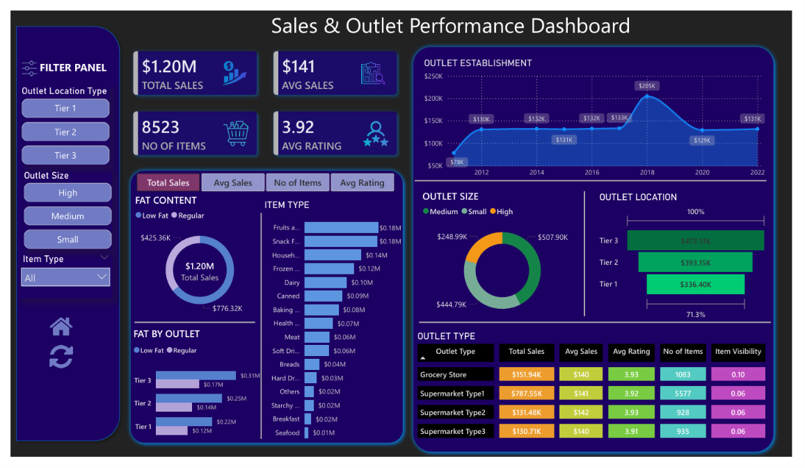

# Supermarket Sales Analysis Dashboard

## Project Overview

An interactive **Power BI dashboard** developed to analyze supermarket sales data and gain insights into sales performance, product categories, and outlet operations. The dashboard transforms raw sales data into meaningful visual insights, enabling users to monitor key performance indicators, compare business performance, and identify sales trends across different outlets and product categories.

## Dashboard Features

- **Key Performance Indicators:** Monitor Total Sales, Average Sales, Number of Items, and Average Rating.
- **Product Analysis:** Explore sales performance across different item types and fat content categories.
- **Outlet Performance:** Compare outlet performance based on sales, average rating, item count, and item visibility.
- **Sales Trends:** Analyze sales performance based on outlet establishment year.
- **Outlet Distribution:** Examine outlets by size and location type.
- **Interactive Filtering:** Explore data dynamically using slicers for outlet location type, outlet size, and item type.
- **Reset Filters:** Restore the dashboard to its default view.

## Dashboard Preview

## Key Metrics

- Total Sales
- Average Sales
- Number of Items
- Average Rating

## Tools & Technologies

- Microsoft Power BI
- Power Query
- DAX
